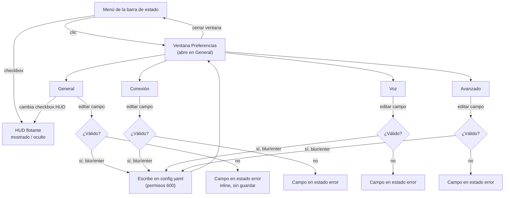

# Preferencias — IA y flujo (Fase 2)

> **Estado: Fase 4 completa.** El wireframe de `wireframes/preferencias.html` (gris, sin tokens) documenta solo la Fase 2 (estructura y flujo). El diseño de alta fidelidad real vive en Penpot, página `02 · Components` — 4 pantallas (`Preferencias · General/Conexión/Voz/Avanzado`).
>
> **Tema: oscuro** (cambiado el 2026-08-03 — el diseño original en claro/nativo-macOS-estándar se consideró "sobrio" y sin estilo propio). Reutiliza el mismo ink de marca que el HUD (`global.color.ink.900`/`.700`) pero **opaco, sin blur**: es una ventana real del sistema, no un overlay de vidrio. Ver `tokens/j-voice-mac.tokens.json` → set `prefs`, y `hud-widget/penpot/README.md` para el detalle de la migración de tokens y las tramas del API encontradas.

## Puntos de entrada

Dos formas de llegar, ambas desde el menú de la barra de estado:

- **"Preferencias…"** (entrada nueva, ver `docs/design/README.md`) → abre la ventana directamente en la pestaña **General**.
- Ninguna otra — no hay atajo de teclado (el spec de menú de julio lo descarta explícitamente) ni acceso desde el HUD.

## Mapa de navegación

**Decisión de guardado: por campo, no "Guardar" al final.** Cada campo válido se persiste al perder el foco o pulsar Enter — el mismo patrón que macOS usa en Preferencias del Sistema desde Big Sur. No hay botón "Guardar"/"Cancelar" global ni estado "sin guardar" que perder al cerrar la ventana. Si un campo es inválido, no se escribe nada y el campo se queda en rojo hasta corregirse; el resto de campos válidos ya se guardaron independientemente.

## Las 4 pestañas — contenido propuesto

Mapeado directamente a `client/config.py`. Todo lo marcado **(?)** es donde te pido que corrijas antes de pasar a Fase 3.

### General

| Campo | Config | Control |
|---|---|---|
| Nombre del dispositivo | `device.id` | Campo de texto |
| Mostrar panel flotante | — (nuevo, D1) | Checkbox |
| Iniciar con el Mac | — (controla `launchd`) **(?)** | Checkbox — abierto si esto debe tocar `launchctl` desde aquí o quedarse solo en el instalador |

### Conexión

| Campo | Config | Control |
|---|---|---|
| Modo de conexión | deriva de si `gateway.url` está presente | Segmented control: "URL completa" / "Host y puerto" |
| URL del gateway | `gateway.url` | Campo de texto (solo visible en modo URL) |
| Host | `gateway.host` | Campo de texto (solo visible en modo Host) |
| Puerto | `gateway.port` | Campo numérico, opcional (solo modo Host) |
| Clave del dispositivo | `gateway.client_key` | Campo enmascarado + botón "revelar" |

`connect_timeout_s` y `scheme` se mueven a Avanzado — son ajustes de red que casi nadie toca.

### Voz

| Campo | Config | Control |
|---|---|---|
| Palabras de activación | `oww.wake_words` | Lista de chips editable ("ok\_nabu" ×) |
| Micrófono | `audio.input_device` | Dropdown, poblado dinámicamente + opción "Automático" |
| Altavoz | `audio.output_device` | Dropdown + "Automático" |
| Silencio para terminar de grabar | `audio.silence_timeout_s` | Slider con unidad "seg" |
| Tiempo máximo de grabación | `audio.recording_timeout_s` | Slider con unidad "seg" |

**(?)** `vad_rms_threshold` (sensibilidad del detector de voz) — ¿entra aquí como slider "Sensibilidad" o se queda en Avanzado? Es el campo más técnico de los que podrían importarle a un usuario final (ajustar falsos positivos/negativos de grabación), pero requiere entender RMS para tocarlo con criterio.

### Avanzado

No lleva controles bonitos por campo — es una lista simple de clave + valor, agrupada por sección, para no diseñar 20+ controles a medida que nadie usa:

- **Conexión avanzada** — `connect_timeout_s`, `scheme`
- **Wake word** — `oww.host`, `oww.port`, `oww.backend`, `oww.idle_detection_timeout_s`, `oww.debounce_s`, `oww.oww_healthcheck_threshold`
- **Audio avanzado** — `sample_rate`, `channels`, `frames_per_buffer`, `preroll_seconds`, `backend`
- **Display remoto (kiosk)** — `display.url`, `display.timeout_s`, `display.backend`
- **Servidor de control** — `control.port`, `control.token_path`, `control.rate_limit_max_requests`, `control.rate_limit_window_s`
- **Menú** — `menubar.refresh_hz`, `menubar.log_path`, `menubar.config_path`
- **Registro** — `logging.level`

Al final: botón **"Abrir config.yaml en el editor"** — retiene el comportamiento de hoy como escape hatch para lo que ni siquiera esta lista cubre.

## Wireframe

Ver `wireframes/preferencias.html` — abrir en el navegador. Cuatro pestañas navegables, gris puro, sin ningún token visual todavía. El propósito es validar la estructura y el conteo de campos por pestaña, no cómo se ve.

## Abierto

- El corte "Voz" vs "Avanzado" de `vad_rms_threshold` (arriba).
- Si "Iniciar con el Mac" controla `launchd` desde aquí.
- Si el patrón de guardado-por-campo (sin botón Guardar) es el que quieres, o prefieres un patrón con Guardar/Cancelar explícito — cambia el diseño de la Fase 4 de forma significativa si se revierte ahora.
